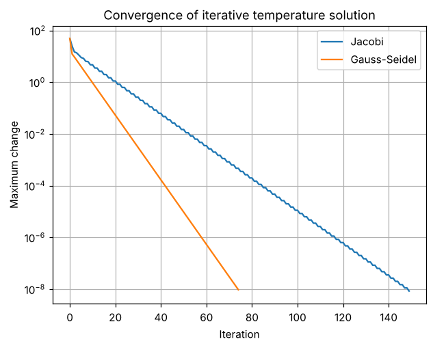
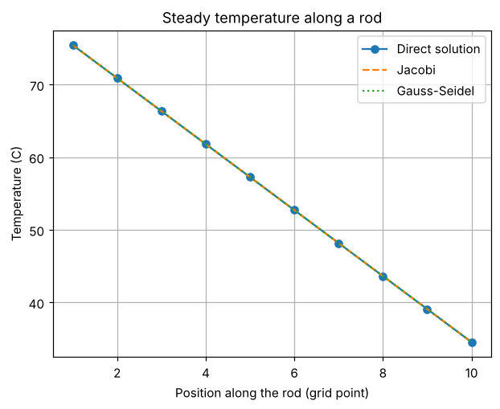

# Task 8: Iterative Methods for Linear Systems

**Program file:** [`code/Task_08_iterative_linear.py`](../code/Task_08_iterative_linear.py)

**Mathematical concept:** Jacobi and Gauss-Seidel start from a guess and repeatedly improve it until the change is below a tolerance.

## 1. Inputs and mathematical operation

**Inputs**

- `A`: 5 x 5 tridiagonal matrix
- `b`: boundary influence (100 C on the left, 20 C on the right)
- `tol = 1e-8`, `max_iter = 500`

**Mathematical operation**

- Jacobi update using the previous estimates
- Gauss-Seidel update using newest estimates
- Track the maximum change per iteration and compare with the direct solution

## 2. Baseline output

```text
Jacobi temperatures: [86.66666665 73.33333331 59.99999997 46.66666664 33.33333332]
Gauss-Seidel temperatures: [86.66666665 73.3333333  59.99999997 46.66666665 33.33333332]
Direct solution: [86.66666667 73.33333333 60.         46.66666667 33.33333333]
```



## 3. Change an input or parameter

**What I changed:** Changed `tol=1e-8` to `tol=1e-4` in both functions, and added print lines for the iteration counts and the errors against the direct solution (the same print lines are in the original run shown first).

| Parameter changed | Original value | New value | Result |
|---|---|---|---|
| Tolerance | 1e-8 | 1e-4 | Jacobi iterations 150 → 86; Gauss-Seidel 75 → 43; Jacobi error vs direct 3.4e-8 → 3.4e-4 |

Original run (with the extra print lines):

```text
Jacobi iterations: 150
Gauss-Seidel iterations: 75
Max error vs direct (Jacobi): 3.4094512102456065e-08
Max error vs direct (Gauss-Seidel): 2.8885636993436492e-08
Jacobi temperatures: [86.66666665 73.33333331 59.99999997 46.66666664 33.33333332]
Gauss-Seidel temperatures: [86.66666665 73.3333333  59.99999997 46.66666665 33.33333332]
Direct solution: [86.66666667 73.33333333 60.         46.66666667 33.33333333]
```

New output (tolerance 1e-8 -> 1e-4):

```text
Jacobi iterations: 86
Gauss-Seidel iterations: 43
Max error vs direct (Jacobi): 0.0003394097491877801
Max error vs direct (Gauss-Seidel): 0.00028755548196102154
Jacobi temperatures: [86.66649696 73.33307878 59.99966059 46.66641211 33.33316363]
Gauss-Seidel temperatures: [86.66647496 73.33304578 59.99971244 46.666451   33.3332255 ]
Direct solution: [86.66666667 73.33333333 60.         46.66666667 33.33333333]
```

**How and why the result changes:** A looser tolerance stops the iteration earlier: Jacobi needed 86 iterations instead of 150 and Gauss-Seidel 43 instead of 75. The price is accuracy: the largest difference from the direct solution grew from about 3e-8 to about 3e-4 degrees. For temperatures near 87 C an error of 0.0003 C is harmless, so a looser tolerance would save time in a real simulation, but a stricter tolerance is needed when high accuracy matters. In both cases Gauss-Seidel used about half the iterations of Jacobi because it uses the newest values immediately.

## 4. Meaning of the output

The five numbers are the steady temperatures at five interior points between a left boundary of 100 C and a right boundary of 20 C. They fall evenly from about 86.7 C to 33.3 C, the straight-line pattern expected in steady heat conduction. Jacobi and Gauss-Seidel agree with the direct solution to about 7 or 8 decimal places. The graph plots the maximum change per iteration on a log scale: both lines slope downwards almost straight, which means the error shrinks by a constant factor each iteration (steady convergence). The Gauss-Seidel line is steeper and reaches the tolerance 1e-8 in 75 iterations compared with 150 for Jacobi.

## 5. Related real-world case

- **Scenario:** Steady temperature along a metal rod with 10 interior grid points, with the left end held at 80 C and the right end at 30 C.
- **Assumptions:**
  - Steady state with no heat loss from the sides of the rod
  - Equal spacing between grid points
  - Tolerance 1e-8, with a higher limit of 5000 iterations because the grid is bigger
- **Input data:** A 10 x 10 tridiagonal matrix (2 on the diagonal, −1 beside it) and b = [80, 0, ..., 0, 30].
- **Modified program:** [`code/Task_08_iterative_linear_case.py`](../code/Task_08_iterative_linear_case.py)

**Output:**

```text
Jacobi iterations: 481
Gauss-Seidel iterations: 244
Direct solution: [75.455 70.909 66.364 61.818 57.273 52.727 48.182 43.636 39.091 34.545]
Max difference, Jacobi vs direct: 1.599670440555201e-07
```



**Interpretation:** The temperature falls in a straight line from 75.5 C near the hot end to 34.5 C near the cold end, about 4.5 C per grid step, the pattern expected for steady conduction. Jacobi needed 481 iterations and Gauss-Seidel 244, again about half. With 10 points both methods needed far more iterations than with 5 points (150 and 75), so bigger grids take more iterations. Jacobi was within 1.6e-7 C of the direct solution. This is why the convergence speed of iterative methods matters for large grids.
