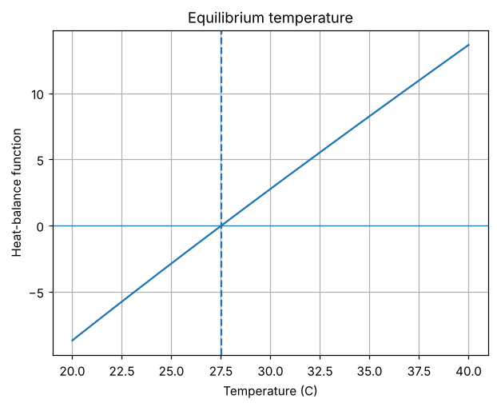
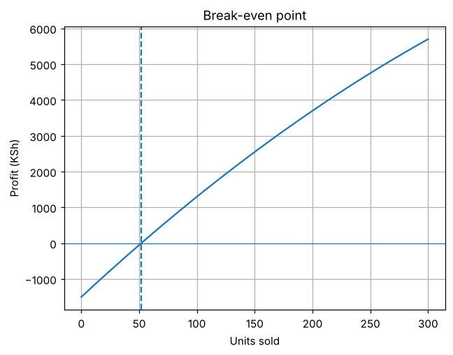

# Task 10: Root Finding: Bisection and Fixed-Point Methods

**Program file:** [`code/Task_10_bisection_fixed_point.py`](../code/Task_10_bisection_fixed_point.py)

**Mathematical concept:** A root of f(x) is where f(x) = 0; bisection halves a sign-change interval and fixed-point iteration repeats x = g(x).

## 1. Inputs and mathematical operation

**Inputs**

- `heat_balance(T) = T - 25 - 10 exp(-T/20)`
- Bracket [20, 40], tolerance 1e-10
- Fixed-point start T = 30

**Mathematical operation**

- Bisection via `root_scalar(..., method='bisect')`
- Fixed-point iteration T_new = 25 + 10 exp(-T/20)
- Plot f(T) and mark the root

## 2. Baseline output

```text
Bisection equilibrium temperature: 27.525211 C
Fixed-point equilibrium temperature: 27.525211 C
Fixed-point iterations: 13
```



## 3. Change an input or parameter

**What I changed:** Changed the ambient temperature `25` to `30` in both `heat_balance` and `g`.

| Parameter changed | Original value | New value | Result |
|---|---|---|---|
| Ambient temperature | 25 C | 30 C | Equilibrium 27.525 C → 32.017 C; fixed-point iterations 13 → 12 |

New output (ambient 25 -> 30):

```text
Bisection equilibrium temperature: 32.017227 C
Fixed-point equilibrium temperature: 32.017227 C
Fixed-point iterations: 12
```

**How and why the result changes:** The equilibrium temperature rose from 27.525 C to 32.017 C, a rise of 4.49 C for a 5 C rise in the ambient temperature. It rose by slightly less than 5 C because the exponential term 10·e^(−T/20) gets smaller at higher T, so the system partly compensates. Both methods still agree, and the fixed-point method needed about the same number of iterations (12 instead of 13). The bracket [20, 40] still contained a sign change, so bisection worked without changing it.

## 4. Meaning of the output

The equilibrium temperature is the value where f(T) = 0, the balance between heat gain and heat loss. Bisection and fixed-point iteration both give 27.525211 C, so the two different methods agree. The fixed-point method converged in 13 iterations. On the graph, f(T) is negative to the left of the dashed vertical line and positive to the right, so the curve crosses zero once at 27.5 C. Because the curve is increasing, there is only one equilibrium in this range.

## 5. Related real-world case

- **Scenario:** Break-even point of a small business: selling price KSh 40 per unit, fixed cost KSh 1500, variable cost KSh 10 per unit and an extra cost of 0.02q² for overtime and crowding. Find the quantity q where profit is zero.
- **Assumptions:**
  - Everything produced is sold at a constant price of KSh 40
  - Cost = 1500 + 10q + 0.02q²
  - Only the lower break-even point is wanted, so the bracket [10, 200] is used
- **Input data:** price = 40, fixed = 1500, variable = 10, crowding = 0.02, with a starting value q = 100 for the fixed-point loop.
- **Modified program:** [`code/Task_10_bisection_fixed_point_case.py`](../code/Task_10_bisection_fixed_point_case.py)

**Output:**

```text
Break-even quantity (bisection): 51.7880 units
Break-even quantity (fixed point): 51.7880 units
Fixed-point iterations: 12
Revenue at break-even: KSh 2071.52
```



**Interpretation:** The business breaks even at 51.788 units (about 52 units), found by both bisection and fixed-point iteration (12 iterations), with revenue of KSh 2071.52 at that point. Below 52 units the business makes a loss and above it a profit; the graph (0 to 300 units) shows profit becoming positive after the dashed break-even line. Profit would turn negative again at very high quantities (near 1448 units) because of the 0.02q² term, but that second crossing is outside the bracket used.
