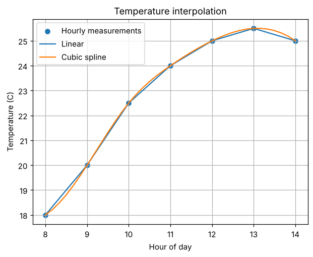
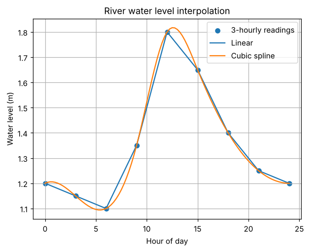

# Task 13: Interpolation

**Program file:** [`code/Task_13_interpolation.py`](../code/Task_13_interpolation.py)

**Mathematical concept:** Interpolation estimates values between known data points (linear: straight lines; cubic spline: smooth curve).

## 1. Inputs and mathematical operation

**Inputs**

- `hours` 8 to 14 and the hourly `temperature` values
- Evaluation every 10 minutes and a target of 10:30

**Mathematical operation**

- Build `interp1d` (linear) and `CubicSpline` from the hourly data
- Evaluate both at 10-minute times and at 10:30

## 2. Baseline output

```text
Linear estimate at 10:30: 23.25 C
Cubic estimate at 10:30: 23.36 C
```



## 3. Change an input or parameter

**What I changed:** Changed the 12:00 temperature `25.0` to `27.0`, and added print lines for the 11:30 estimates (also in the original run shown first).

| Parameter changed | Original value | New value | Result |
|---|---|---|---|
| Temperature at 12:00 | 25.0 C | 27.0 C | Estimate at 10:30: linear unchanged at 23.25 C, cubic 23.36 → 23.12 C; at 11:30: linear 24.50 → 25.50 C, cubic 24.54 → 25.70 C |

Original run (with the extra print lines):

```text
Linear estimate at 10:30: 23.25 C
Cubic estimate at 10:30: 23.36 C
Linear estimate at 11:30: 24.50 C
Cubic estimate at 11:30: 24.54 C
```

New output (12:00 temperature 25.0 -> 27.0):

```text
Linear estimate at 10:30: 23.25 C
Cubic estimate at 10:30: 23.12 C
Linear estimate at 11:30: 25.50 C
Cubic estimate at 11:30: 25.70 C
```

**How and why the result changes:** Linear interpolation only uses the two points on either side of the target time, so the 10:30 estimate (between 10:00 and 11:00) did not change, while the 11:30 estimate (between 11:00 and 12:00) rose by 1.0 C, half of the 2 C change. The cubic spline is one smooth curve through all the points, so a change at one point affects the estimates everywhere: the cubic estimate at 10:30 fell from 23.36 to 23.12 C even though 10:30 is far from 12:00, because the whole curve bends differently. At 11:30 the cubic estimate rose by 1.16 C, a little more than the linear one, because the spline curves up towards the new higher point.

## 4. Meaning of the output

The sensor measured the temperature once an hour and the program estimates it at any time in between. At 10:30 the linear estimate is 23.25 C (the midpoint of 22.5 and 24.0) and the cubic estimate is 23.36 C. The graph shows the seven measured points as dots, the linear estimate as straight segments between them and the cubic spline as a smooth curve through the same points. The curves agree at the measured points and differ slightly between them. Temperature changes smoothly in reality, so the spline is usually the more realistic estimate, while linear interpolation is simpler and never goes beyond the measured values.

## 5. Related real-world case

- **Scenario:** A river gauge records the water level every 3 hours. Estimate the level every 15 minutes, in particular at 07:30, and the highest level of the day.
- **Assumptions:**
  - The water level changes smoothly between readings (no sudden floods)
  - Readings are accurate and taken at exactly the stated times
  - Estimates are only made inside the measured period 00:00 to 24:00
- **Input data:** 9 readings from 00:00 to 24:00, from 1.10 m (06:00) to 1.80 m (12:00).
- **Modified program:** [`code/Task_13_interpolation_case.py`](../code/Task_13_interpolation_case.py)

**Output:**

```text
Linear estimate at 07:30: 1.225 m
Cubic estimate at 07:30: 1.174 m
Highest estimated level (cubic): 1.817 m at hour 12.50
```



**Interpretation:** At 07:30 the linear estimate is 1.225 m and the cubic estimate is 1.174 m. The level is lowest at 06:00 (1.10 m) and rising afterwards, and the spline dips slightly below the straight line before the rise, so the two estimates differ by about 5 cm. The cubic estimate of the highest level is 1.817 m at 12:30, slightly above the highest reading (1.80 m at 12:00). This shows that the spline can suggest a peak between readings, but it is an estimate, not a measurement.
