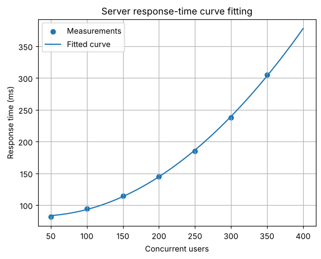
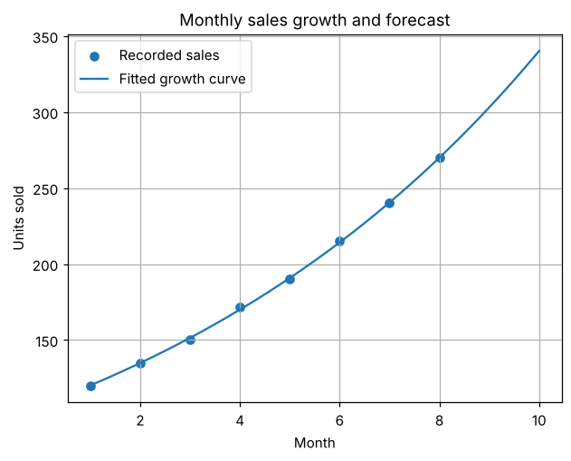

# Task 14: Curve Fitting and Approximation

**Program file:** [`code/Task_14_curve_fitting.py`](../code/Task_14_curve_fitting.py)

**Mathematical concept:** Curve fitting chooses model parameters that minimise the sum of squared residuals between data and model.

## 1. Inputs and mathematical operation

**Inputs**

- `users`: 50 to 350 concurrent users
- `response_ms`: measured response times
- Quadratic model a x^2 + b x + c

**Mathematical operation**

- Fit the parameters with `curve_fit`
- Compute RMSE
- Predict the response at 400 users and plot data and fitted curve

## 2. Baseline output

```text
Fitted model: y = 0.002167x^2 + -0.1345x + 85.00
RMSE: 1.55 ms
Predicted response at 400 users: 377.86 ms
```



## 3. Change an input or parameter

**What I changed:** Added a new measurement (400 users, 385 ms) to the data, and added a print line for the prediction at 800 users (also in the original run shown first).

| Parameter changed | Original value | New value | Result |
|---|---|---|---|
| Data | 7 points | 8 points (added 400 users, 385 ms) | a: 0.002167 → 0.002286; RMSE 1.55 → 1.99 ms; prediction at 400 users 377.86 → 382.92 ms; at 800 users 1364 → 1410 ms |

Original run (with the extra print lines):

```text
Fitted model: y = 0.002167x^2 + -0.1345x + 85.00
RMSE: 1.55 ms
Predicted response at 400 users: 377.86 ms
Predicted response at 800 users: 1364.05 ms
```

New output (add a measurement: 400 users -> 385 ms):

```text
Fitted model: y = 0.002286x^2 + -0.1762x + 87.68
RMSE: 1.99 ms
Predicted response at 400 users: 382.92 ms
Predicted response at 800 users: 1409.58 ms
```

**How and why the result changes:** Adding a real measurement at 400 users (385 ms) shows how good the first prediction was: the model had predicted 377.86 ms, about 7 ms (2%) too low. After refitting, the curve bends up slightly more (a rises from 0.002167 to 0.002286) and the prediction for 400 users becomes 382.92 ms, closer to the measurement. The RMSE rose from 1.55 to 1.99 ms because the new point is not exactly on the first curve. The prediction for 800 users changed from 1364 ms to 1410 ms, a difference of 46 ms from a single extra point, which shows that predictions far outside the measured range are very sensitive to the data and not reliable.

## 4. Meaning of the output

The fitted model y = 0.002167x² − 0.1345x + 85.00 describes how response time grows with the number of users: about 85 ms with almost no load, and the quadratic term makes it rise faster as users increase. The RMSE of 1.55 ms means that the model matches the measured times to within about 1.5 ms on average, a very good fit. The prediction at 400 users is 377.86 ms. On the graph the seven measurements lie very close to the fitted curve, which curves upwards, meaning that each extra user adds more delay than the previous one.

## 5. Related real-world case

- **Scenario:** A shop's monthly sales grow quickly over 8 months. Fit an exponential growth curve and forecast months 9 and 10.
- **Assumptions:**
  - Sales grow by a constant percentage each month (model sales = a·e^(b·month))
  - The pattern continues for the next two months
  - There are no seasonal effects or stock limits
- **Input data:** Months 1 to 8 with sales of 120, 135, 150, 172, 190, 215, 240 and 270 units.
- **Modified program:** [`code/Task_14_curve_fitting_case.py`](../code/Task_14_curve_fitting_case.py)

**Output:**

```text
Fitted model: sales = 107.01 * exp(0.1157 * month)
Monthly growth rate: 12.26%
RMSE: 0.98 units
Forecast for month 9: 303.1 units
Forecast for month 10: 340.3 units
```



**Interpretation:** The fitted model is sales = 107.01·e^(0.1157·month), which means that sales grow by about 12.26% a month. The RMSE is 0.98 units, so the curve follows the data closely. The forecasts are 303.1 units for month 9 and 340.3 units for month 10. The forecast is only reliable if the growth continues at the same rate; a shop with limited stock or a seasonal slowdown would sell less, so the forecast should only be used for the near future.
