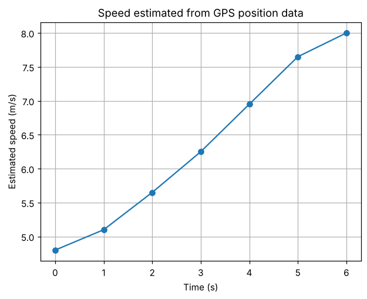
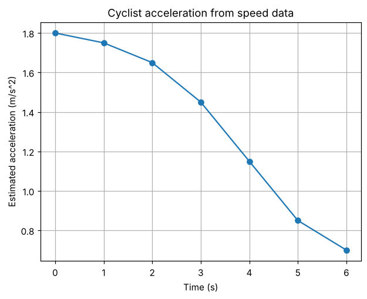

# Task 15: Numerical Differentiation

**Program file:** [`code/Task_15_numerical_differentiation.py`](../code/Task_15_numerical_differentiation.py)

**Mathematical concept:** A derivative measures the rate of change; with data it is approximated from neighbouring values (forward, central, backward differences).

## 1. Inputs and mathematical operation

**Inputs**

- `time` 0 to 6 s
- `position` GPS values in metres

**Mathematical operation**

- Forward difference at the first point
- Central difference for interior points
- Backward difference at the last point

## 2. Baseline output

```text
t=0s, position=0.0m, estimated speed=4.80m/s
t=1s, position=4.8m, estimated speed=5.10m/s
t=2s, position=10.2m, estimated speed=5.65m/s
t=3s, position=16.1m, estimated speed=6.25m/s
t=4s, position=22.7m, estimated speed=6.95m/s
t=5s, position=30.0m, estimated speed=7.65m/s
t=6s, position=38.0m, estimated speed=8.00m/s
```



## 3. Change an input or parameter

**What I changed:** Changed the position at t = 3 s from `16.1` to `17.5`.

| Parameter changed | Original value | New value | Result |
|---|---|---|---|
| Position at t = 3 s | 16.1 m | 17.5 m | Speed at 2 s: 5.65 → 6.35 m/s; at 4 s: 6.95 → 6.25 m/s; at 3 s unchanged at 6.25 m/s |

New output (position at t=3 s: 16.1 -> 17.5):

```text
t=0s, position=0.0m, estimated speed=4.80m/s
t=1s, position=4.8m, estimated speed=5.10m/s
t=2s, position=10.2m, estimated speed=6.35m/s
t=3s, position=17.5m, estimated speed=6.25m/s
t=4s, position=22.7m, estimated speed=6.25m/s
t=5s, position=30.0m, estimated speed=7.65m/s
t=6s, position=38.0m, estimated speed=8.00m/s
```

**How and why the result changes:** The central difference at t = 3 s uses the positions at 2 s and 4 s, not the position at 3 s itself, so the speed at t = 3 s did not change. The speeds at t = 2 s and t = 4 s do use the changed position: at 2 s it became (17.5 − 4.8) / 2 = 6.35 m/s (it was 5.65) and at 4 s it became (30.0 − 17.5) / 2 = 6.25 m/s (it was 6.95). One error of 1.4 m in a position (like GPS noise) therefore produces errors of +0.7 and −0.7 m/s in the neighbouring speeds and flattens the speed curve at 6.25 m/s for 3 s and 4 s. Differences amplify noise, so derivatives of noisy data are less accurate than the data itself.

## 4. Meaning of the output

The distance covered each second increases (4.8, 5.4, 5.9, 6.6, 7.3 and 8.0 m), so the vehicle is speeding up. The estimated speed rises from 4.80 m/s at t = 0 to 8.00 m/s at t = 6 s, by roughly 0.6 to 0.7 m/s every second in the middle. Interior points use central differences, which use both neighbours and are more accurate; the first and last points use one-sided differences and are less reliable. The graph is a smooth upward curve of speed against time.

## 5. Related real-world case

- **Scenario:** A cyclist's speed is read from a bike computer every second for 6 seconds. Estimate the acceleration.
- **Assumptions:**
  - Speed readings are accurate to 0.1 m/s
  - Readings are exactly 1 second apart
  - The cyclist rides in a straight line
- **Input data:** Time 0 to 6 s and speed 0, 1.8, 3.5, 5.1, 6.4, 7.4 and 8.1 m/s.
- **Modified program:** [`code/Task_15_numerical_differentiation_case.py`](../code/Task_15_numerical_differentiation_case.py)

**Output:**

```text
t=0s, speed=0.0m/s, estimated acceleration=1.80m/s^2
t=1s, speed=1.8m/s, estimated acceleration=1.75m/s^2
t=2s, speed=3.5m/s, estimated acceleration=1.65m/s^2
t=3s, speed=5.1m/s, estimated acceleration=1.45m/s^2
t=4s, speed=6.4m/s, estimated acceleration=1.15m/s^2
t=5s, speed=7.4m/s, estimated acceleration=0.85m/s^2
t=6s, speed=8.1m/s, estimated acceleration=0.70m/s^2
```



**Interpretation:** The estimated acceleration starts at 1.80 m/s² and falls steadily to 0.70 m/s² at 6 s. The cyclist is always speeding up (the acceleration is positive), but the push gets weaker as the speed rises, as expected from air resistance and limited pedalling power. The graph slopes downward. The first and last values come from one-sided differences, so they are less accurate than the interior ones.
