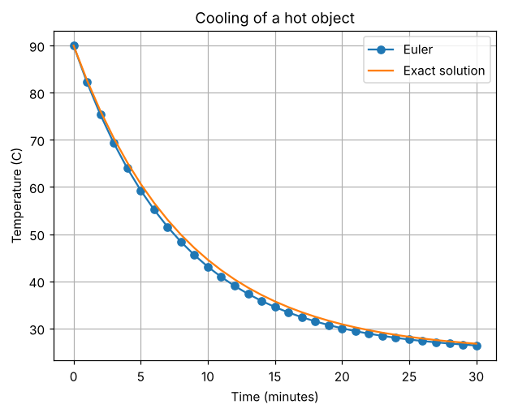
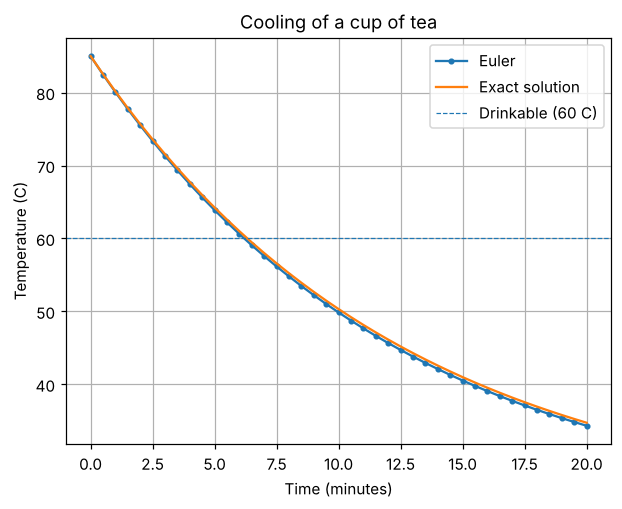

# Task 17: Ordinary Differential Equations: Euler Method

**Program file:** [`code/Task_17_euler_ode.py`](../code/Task_17_euler_ode.py)

**Mathematical concept:** Euler's method steps forward with y(n+1) = y(n) + h f(t(n), y(n)); smaller h usually means better accuracy.

## 1. Inputs and mathematical operation

**Inputs**

- Ambient 25 C, initial 90 C, k = 0.12 per minute
- Step size h = 1 minute, end time 30 minutes

**Mathematical operation**

- Repeat the Euler update for each step
- Compare with the exact solution T = T_amb + (T0 - T_amb) e^(-kt)
- Final absolute error and plot

## 2. Baseline output

```text
Euler temperature after 30 min: 26.40 C
Exact temperature after 30 min: 26.78 C
Final absolute error: 0.3720 C
```



## 3. Change an input or parameter

**What I changed:** Changed the step size `h = 1.0` to `h = 5.0` and then to `h = 0.1`.

| Parameter changed | Original value | New value | Result |
|---|---|---|---|
| Step size h | 1.0 min | 5.0 min | Euler at 30 min 26.40 → 25.27 C (exact 26.78 C); error 0.372 → 1.510 C |
| Step size h | 1.0 min | 0.1 min | Euler at 30 min 26.74 C; error 0.0383 C |

New output (h 1.0 -> 5.0):

```text
Euler temperature after 30 min: 25.27 C
Exact temperature after 30 min: 26.78 C
Final absolute error: 1.5098 C
```

New output (h 1.0 -> 0.1):

```text
Euler temperature after 30 min: 26.74 C
Exact temperature after 30 min: 26.78 C
Final absolute error: 0.0383 C
```

**How and why the result changes:** The exact answer after 30 minutes is 26.78 C. With h = 1 the Euler error is 0.372 C. With h = 5 the error rises to 1.510 C (about 4 times bigger) and with h = 0.1 it falls to 0.038 C (about 10 times smaller). The error is roughly proportional to h, which is how a first-order method such as Euler behaves: each step uses only the slope at the start of the step, so a large step drifts away from the curve. A smaller step is more accurate but needs more steps (300 instead of 30 for h = 0.1).

## 4. Meaning of the output

The object starts at 90 C in a room at 25 C and cools. After 30 minutes the Euler method gives 26.40 C while the exact solution gives 26.78 C, so the object is almost at room temperature and the Euler answer is 0.37 C too low. On the graph the temperature drops quickly at first and then flattens, because the cooling rate is proportional to the difference from the ambient temperature, −k(T − T_ambient), which gets smaller as the object cools. The Euler curve follows the exact curve closely but lies slightly below it.

## 5. Related real-world case

- **Scenario:** A cup of tea poured at 85 C in a 22 C room cools with k = 0.08 per minute. How long until it reaches a comfortable 60 C?
- **Assumptions:**
  - Newton's law of cooling applies
  - The room stays at 22 C
  - k = 0.08 per minute (assumed for this cup)
  - Step size 0.5 minutes
- **Input data:** T_initial = 85, T_ambient = 22, k = 0.08, h = 0.5 and an end time of 20 minutes.
- **Modified program:** [`code/Task_17_euler_ode_case.py`](../code/Task_17_euler_ode_case.py)

**Output:**

```text
Euler temperature after 20 min: 34.31 C
Exact temperature after 20 min: 34.72 C
Final absolute error: 0.4114 C
Euler: tea first at or below 60 C at t = 6.5 min
Exact: tea reaches 60 C at t = 6.32 min
```



**Interpretation:** The Euler method says that the tea first falls to 60 C or below at 6.5 min, while the exact solution gives 6.32 min. The difference of 0.18 min (about 11 seconds) comes from the step size of 0.5 min. After 20 minutes the tea is at 34.3 C by Euler and 34.7 C exactly, an error of 0.41 C. So the tea is drinkable after about 6 to 7 minutes. The graph shows the tea cooling quickly at first and levelling off towards room temperature, and the dashed line marks 60 C.
