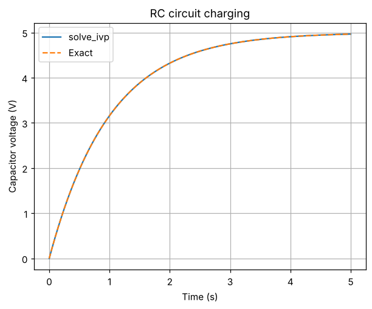
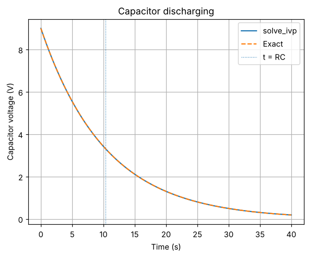

# Task 18: Numerical Solution of ODEs Using SciPy

**Program file:** [`code/Task_18_scipy_ode.py`](../code/Task_18_scipy_ode.py)

**Mathematical concept:** `solve_ivp` solves dy/dt = f(t, y) with adaptive step sizes and returns values at the requested times.

## 1. Inputs and mathematical operation

**Inputs**

- Vs = 5 V, R = 1000 ohms, C = 0.001 F, V0 = 0 V
- Time interval 0 to 5 s with 200 evaluation points

**Mathematical operation**

- RC circuit equation dV/dt = (Vs - V)/(RC)
- Solve with `solve_ivp`
- Compare with the exact curve Vs(1 - e^(-t/RC)) and plot

## 2. Baseline output

```text
Solver success: True
Capacitor voltage at 5 s: 4.9663 V
Maximum error against exact solution: 9.282e-10 V
```



## 3. Change an input or parameter

**What I changed:** Changed `R = 1000.0` to `R = 2000.0`.

| Parameter changed | Original value | New value | Result |
|---|---|---|---|
| Resistance R | 1000 ohms | 2000 ohms | Voltage at 5 s: 4.9663 V → 4.5896 V |

New output (R 1000 -> 2000 ohms):

```text
Solver success: True
Capacitor voltage at 5 s: 4.5896 V
Maximum error against exact solution: 6.740e-10 V
```

**How and why the result changes:** Doubling R doubles the time constant RC from 1 s to 2 s, so the capacitor charges more slowly. After 5 seconds the voltage is 5(1 − e^(−5/2)) = 4.5896 V instead of 5(1 − e^(−5)) = 4.9663 V, so it has reached 91.8% of the supply voltage instead of 99.3%. The numerical solution still matches the exact solution, with an error of about 7e-10 V.

## 4. Meaning of the output

The capacitor starts at 0 V and charges towards the 5 V supply. The time constant is RC = 1000 x 0.001 = 1 s, so after 5 s (five time constants) the capacitor is at 4.9663 V, which is 99.3% of the supply voltage. On the graph the curve rises quickly and then flattens as it approaches 5 V, and the dashed exact curve lies on top of the `solve_ivp` curve. The maximum error of 9.28e-10 V is tiny, which shows that `solve_ivp` with these tolerances is very accurate.

## 5. Related real-world case

- **Scenario:** A capacitor charged to 9 V discharges through a 2200-ohm resistor, with C = 0.0047 F. How does the voltage fall, and how long until it is below 1 V?
- **Assumptions:**
  - Ideal resistor and capacitor with no leakage
  - Discharge follows dV/dt = −V/(RC)
  - Initial voltage 9 V
  - Time interval 0 to 40 s
- **Input data:** R = 2200 ohms, C = 0.0047 F and V0 = 9 V.
- **Modified program:** [`code/Task_18_scipy_ode_case.py`](../code/Task_18_scipy_ode_case.py)

**Output:**

```text
Solver success: True
Time constant RC: 10.34 s
Voltage at t = RC: 3.311 V (36.8% of the starting voltage)
Voltage at 20 s: 1.301 V
Voltage first below 1 V at about t = 22.75 s (exact 22.72 s)
Maximum error against exact solution: 2.143e-09 V
```



**Interpretation:** The time constant is RC = 10.34 s. After one time constant the voltage is 3.311 V, which is 36.8% of 9 V, as theory predicts. After 20 s the voltage is 1.301 V, and it first falls below 1 V at about 22.75 s (exact value 22.72 s). The numerical error is about 2e-9 V. For a backup circuit, this means the capacitor can hold the load above 1 V for about 23 seconds. The graph shows a fast fall at the start that slows down as the voltage approaches zero.
