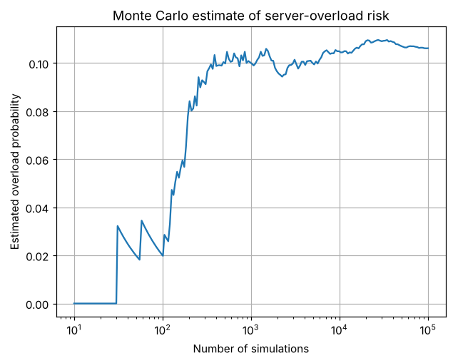
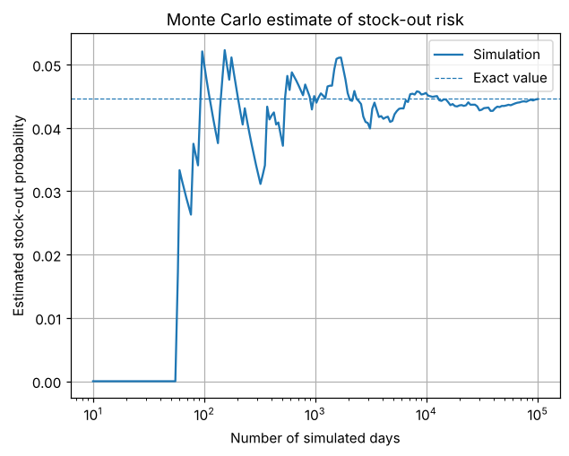

# Task 20: Random Numbers and Monte Carlo Methods

**Program file:** [`code/Task_20_monte_carlo.py`](../code/Task_20_monte_carlo.py)

**Mathematical concept:** Monte Carlo methods estimate quantities by repeated random sampling; the observed fraction approaches the true probability as N grows.

## 1. Inputs and mathematical operation

**Inputs**

- Capacity 1000, mean demand 850, standard deviation 120
- N = 100,000 simulations, seed 42

**Mathematical operation**

- Simulate demand with a normal distribution
- Overload probability = overloaded cases / N
- Running probability to show convergence

## 2. Baseline output

```text
Estimated overload probability: 10.6160%
Number of overload cases: 10616 out of 100000
```



## 3. Change an input or parameter

**What I changed:** Changed `capacity = 1000.0` to `capacity = 1100.0`.

| Parameter changed | Original value | New value | Result |
|---|---|---|---|
| Capacity | 1000 | 1100 | Overload probability 10.616% → 1.912% |

New output (capacity 1000 -> 1100):

```text
Estimated overload probability: 1.9120%
Number of overload cases: 1912 out of 100000
```

**How and why the result changes:** Raising the capacity by 100 units puts it further above the mean demand of 850, from 1.25 standard deviations away to 2.08. The probability that demand exceeds capacity therefore falls sharply, from 10.6% to 1.9%, because the tail of a normal distribution shrinks quickly. These values match theory (about 10.6% and 1.9%), so the simulation is reliable. More capacity gives a big reduction in risk, but each further increase gives a smaller improvement.

## 4. Meaning of the output

The program simulates 100,000 days of random server demand (average 850, standard deviation 120) and counts the days when demand exceeds the capacity of 1000. About 10,616 of 100,000 days (10.62%) are overloads. For the operator this means that roughly one day in ten the server would be overloaded, so more capacity or load balancing is needed. The graph shows the running estimate of the probability against the number of simulations on a log scale: it fluctuates a lot for few simulations and then settles near 10.6% as the number grows, showing that Monte Carlo estimates become reliable with many samples.

## 5. Related real-world case

- **Scenario:** A shop starts the day with 25 units of an item. Daily demand is random, with an average of 18 (a Poisson distribution). What is the probability that it runs out of stock?
- **Assumptions:**
  - Demand follows a Poisson distribution with mean 18 per day (assumed)
  - Days are independent
  - There is no restocking during the day
  - 100,000 days are simulated
- **Input data:** stock = 25, mean_demand = 18, N = 100,000 and seed 42.
- **Modified program:** [`code/Task_20_monte_carlo_case.py`](../code/Task_20_monte_carlo_case.py)

**Output:**

```text
Estimated stock-out probability: 4.4550%
Exact probability (Poisson): 4.4608%
Stock-out days: 4455 out of 100000
```



**Interpretation:** The simulation estimates a stock-out probability of 4.455% (4455 days out of 100,000). The exact Poisson probability is 4.461%, so the Monte Carlo estimate is within 0.006 percentage points of the true value, which validates the method. In practice the shop would run out of this item on about 1 day in 22. If that is too often, the owner can stock more units and run the program again with a higher stock level. The graph shows the running estimate settling on the exact value as more days are simulated.
